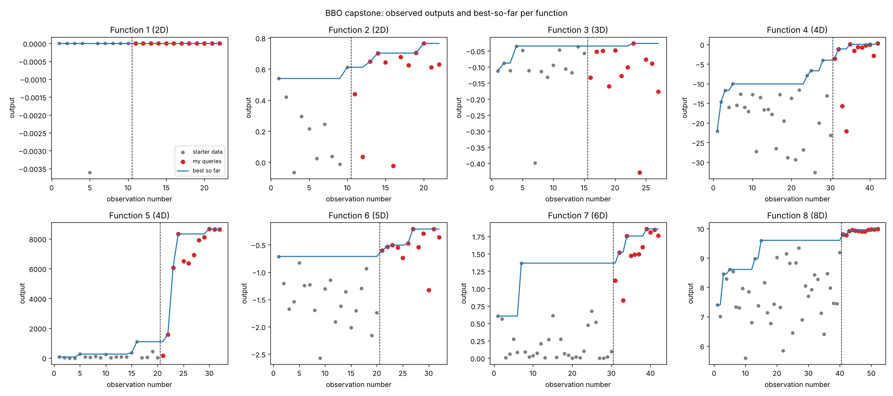

# IC-ML-AI-Capstone: Black-Box Optimisation Challenge

## Summary

This project is the capstone for the Imperial College London / Emeritus Professional Certificate in Machine Learning and Artificial Intelligence. The challenge is to find the inputs that give the highest output for eight hidden functions, without knowing their formulas and with only one test per function each round. This is like tuning an expensive experiment, such as a drug formulation or a factory process, where every test costs time and money. Each round, a statistical model learns from all results so far and suggests the most promising next test, balancing safe improvements against trying unexplored options. This repository records that process, its results and its limitations.

**Where things stand:** through Round 12 (12 real portal results logged per function beyond the starter data), every one of the eight functions has improved on its starter-data best — gains range from a roughly 5,000x improvement for Function 1 (which has an extremely narrow near-zero optimum) to a full sign flip for Function 4 (from -4.03 to +0.27). See [Results](#results) below for the full table and [Challenges and Insights](#challenges-and-insights) for what drove each one. Settings per function have not needed changing since Round 1 — see the Model Card's Change Log for why.

## Repository Structure

```
IC-ML-AI-Capstone/
├── README.md
├── requirements.txt
├── Data/
│   ├── function_1/ ... function_8/
│   │   ├── initial_inputs.npy       official starter inputs
│   │   └── initial_outputs.npy      official starter outputs
│   └── submissions.json             my queries + real portal outputs, by round
├── Code/
│   ├── bbo_core.py                  data loading, GP surrogate, acquisition, formatting
│   ├── run_round.py                 produces one query per function for a round
│   ├── plot_progress.py             best-so-far plot for all eight functions
│   └── BBO_round_walkthrough.ipynb  step-by-step notebook version of a round, committed with its outputs
├── Results/
│   ├── round_NN_queries.json        query, settings, seed and diagnostics per round
│   └── progress.png                 progress plot
└── Documentation/
    ├── Datasheet.md
    └── Model_Card.md
```

This is the only structure that should exist in the repo root and under `Data/`, `Code/`, `Results/` and `Documentation/`. There is no root-level `bbo.py`, `cli.py`, `config.json`, `DATASHEET.md`/`MODEL_CARD.md`, `Data/rounds/`, `observations.csv` or standalone analysis notebook — those were earlier scratch files superseded by `Code/bbo_core.py` + `Code/run_round.py`, `Data/submissions.json`, and `Documentation/Datasheet.md` + `Documentation/Model_Card.md` respectively, and have been removed so nothing stale is left for a reader to open by mistake.

## Documentation

- **[Datasheet](Documentation/Datasheet.md)**: what the data is, how it was collected, transformations, intended uses and limitations.
- **[Model Card](Documentation/Model_Card.md)**: how the optimiser works, settings per function and why, performance metrics, assumptions, limitations and ethics.

## The Problem

- Eight functions with 2 to 8 inputs each, every input between 0 and 1
- Each returns one number, and every function is treated as **maximisation**
- One query per function per round, submitted through the capstone portal as `x1-x2-...-xn` (six decimals, hyphens, no spaces)

## Approach

Bayesian optimisation with a Gaussian Process surrogate for each function. The GP predicts both a value and its uncertainty, and an acquisition function (Upper Confidence Bound or Expected Improvement) picks the next query by balancing the two. Settings are tuned per function from the official descriptions and the observed data. See the [Model Card](Documentation/Model_Card.md) for the full table.

**Why Bayesian optimisation?** Evaluations are expensive and limited, the functions may be noisy and have several peaks, and Bayesian optimisation is designed to make the most of every evaluation by using uncertainty to decide where to look next.

## How to Run a Round

```bash
pip install -r requirements.txt

# 1. Log last round's real portal results in Data/submissions.json, e.g.
#    "function_1": [{"round": 1, "x": [0.214116, 0.834905], "y": 0.123}]

# 2. Generate this round's queries (add --loo for leave-one-out diagnostics)
python Code/run_round.py --round 2 --loo

# 3. Update the progress plot
python Code/plot_progress.py
```

Or open `Code/BBO_round_walkthrough.ipynb` from inside the `Code/` folder and run all cells.

## Results



| Function | Starting best (starter data) | Best output so far | Round found |
|---|---|---|---|
| 1 | 7.711e-16 | 4.135e-12 | 9 |
| 2 | 0.6112 | 0.7648 | 10 |
| 3 | -0.0348 | -0.0266 | 8 |
| 4 | -4.0255 | 0.2729 | 12 |
| 5 | 1,088.86 | 8,662.41 | 10 |
| 6 | -0.7143 | -0.2120 | 11 |
| 7 | 1.3650 | 1.8556 | 9 |
| 8 | 9.5985 | 9.9846 | 12 |

*(12 real rounds submitted so far; table updates each round from `Data/submissions.json`. See the Model Card's Performance section for the round-by-round breakdown and LOO calibration trend.)*

## Challenges and Insights

- **Function 1** has an extremely narrow optimum near zero (best observed only reached 4.135e-12, five orders of magnitude above the starter best of 7.71e-16, but still effectively flat everywhere else), so most queries are fine local refinement rather than broad exploration — the rank transform keeps this near-zero region from being invisible to the GP.
- **Function 4** was the biggest turnaround: it started at -4.03, improved modestly to -3.62 after Round 1, then jumped all the way to +0.27 by Round 12 — a full sign flip. This came in fits and starts rather than a steady climb, consistent with a landscape that has several local optima the signed-log transform helps the GP compare fairly.
- **Functions 5 and 8** improved quickly and kept inching upward (Function 5 from 1,088.86 to 8,662.41; Function 8 from 9.60 to 9.98), matching their "fairly flat with one dominant peak" descriptions — most of the gain came from finding the peak's general neighbourhood, with later rounds squeezing out smaller refinements.
- **Function 6** improved steadily but noisily — a strong jump by Round 7, then a bad round (-1.33 at Round 11) before recovering to a new best the very next round. This is a reminder that "best so far" is monotonic by construction even when individual queries are worse than the current best; the acquisition function is allowed to explore and occasionally take a step that doesn't pay off.
- **Function 5** has the widest output range by far (hundreds to thousands) and needed a `log1p`-style transform before the GP; without it a handful of large values would dominate the kernel fit and starve the rest of the input space of attention.
- Leave-one-out diagnostics (`--loo` flag) have been useful for sanity-checking whether a function's GP is well-calibrated (calibration ratio near 1) versus overconfident. Functions 7 and 8 have drifted toward being underconfident (ratio well below 1) as data clusters near their optima — worth a closer look in the Model Card if that trend continues, though it hasn't stalled their improvement so far.
